<div align="center">

# 🔬 Data Science Portfolio — Tasks 1–10

### End-to-end analytics: from raw data to statistical inference, delivered as an interactive dashboard

[](https://data-science-internship-at-happieloop-technologies-f5uxh7gxzdm.streamlit.app/)
[](https://clever-jelly-a82e9f.netlify.app)


**[▶ Launch the Live Dashboard](https://data-science-internship-at-happieloop-technologies-f5uxh7gxzdm.streamlit.app/)** · **[📓 Browse Notebooks](#-notebooks)** · **[⚡ Run Locally](#-quick-start)**

</div>

---

## 👋 TL;DR for Recruiters

| | |
|---|---|
| **What this is** | 10 core data-science tasks, each built as a documented **Jupyter notebook** *and* an **interactive Streamlit page** |
| **Skills shown** | Data cleaning · EDA · statistics & hypothesis testing · regression · data visualization · Pandas manipulation · app deployment |
| **Scale** | 10 notebooks · ~1,400-line Streamlit app · 40+ interactive views · live cloud deployment |
| **Time to evaluate** | **2 minutes** → open the [live demo](https://data-science-internship-at-happieloop-technologies-f5uxh7gxzdm.streamlit.app/) and click through the sidebar |
| **Open to** | Data Analyst / Data Scientist roles (fresher) |

> 💡 **No setup needed to review.** Everything is hosted — just click the demo link.

---

## 🖼️ Dashboard Preview

<div align="center">

| 🏠 Home | 🧭 Sidebar Navigation | 📊 Task 1 · Statistical Analysis |
|:---:|:---:|:---:|
| 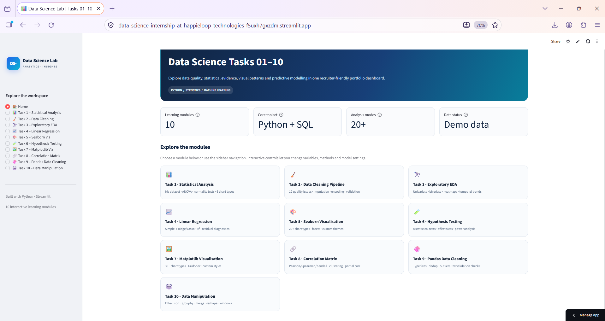 | 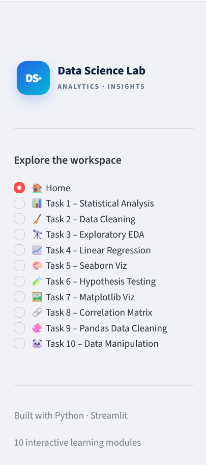 | 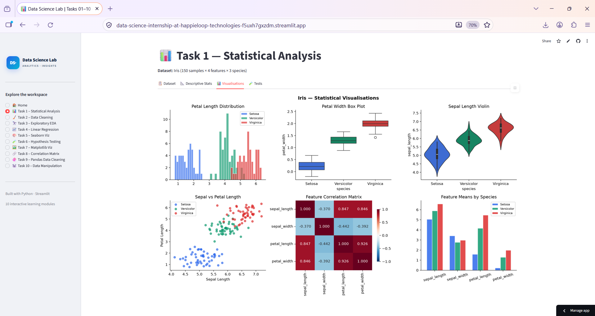 |

| 🧹 Task 2 · Data Cleaning | 🔭 Task 3 · Exploratory EDA | 📈 Task 4 · Linear Regression |
|:---:|:---:|:---:|
| 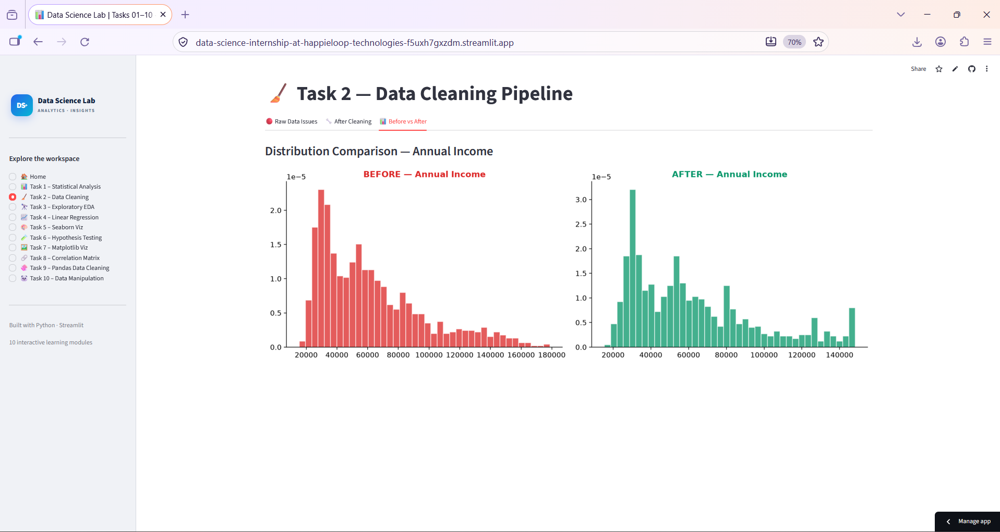 | 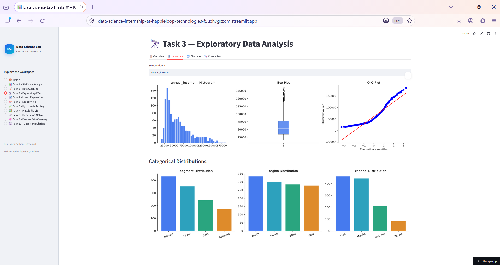 | 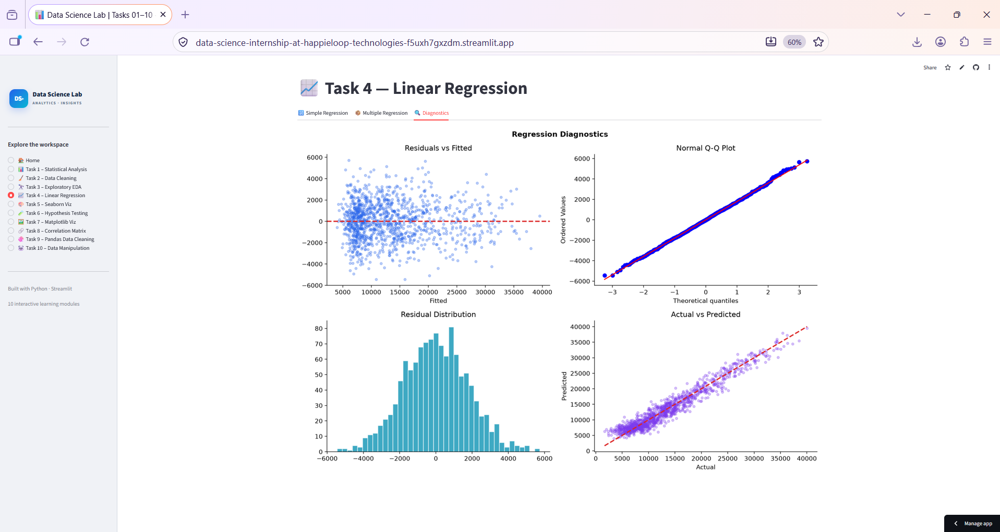 |

| 🎨 Task 5 · Seaborn Viz | 🧪 Task 6 · Hypothesis Testing | 🖼️ Task 7 · Matplotlib Viz |
|:---:|:---:|:---:|
| 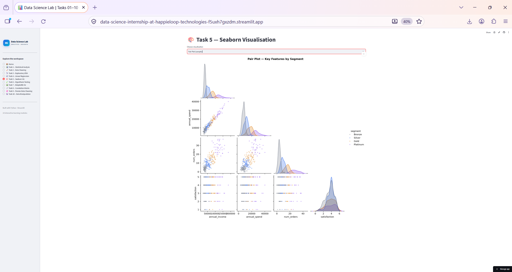 | 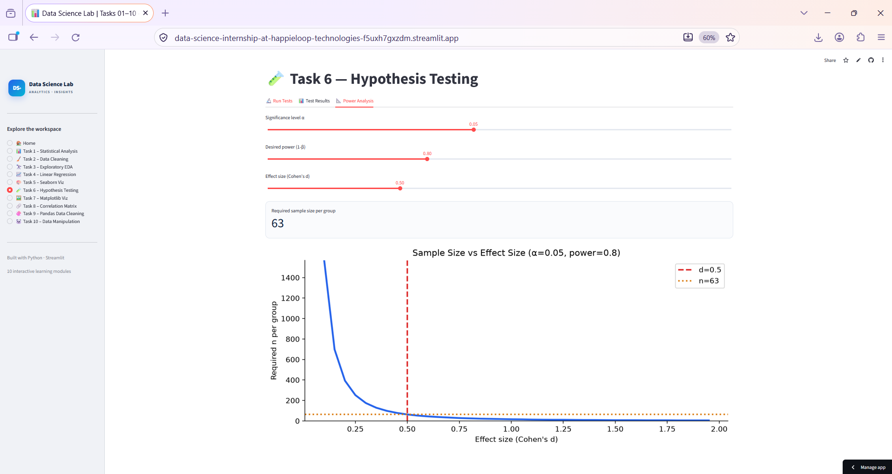 | 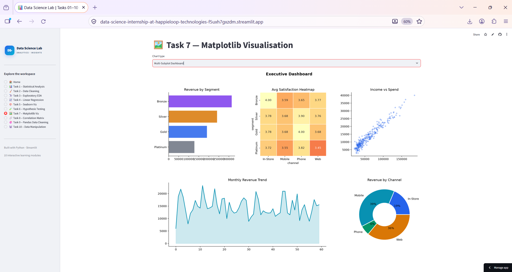 |

| 🔗 Task 8 · Correlation Matrix | 🧼 Task 9 · Pandas Cleaning | 🐼 Task 10 · Data Manipulation |
|:---:|:---:|:---:|
| 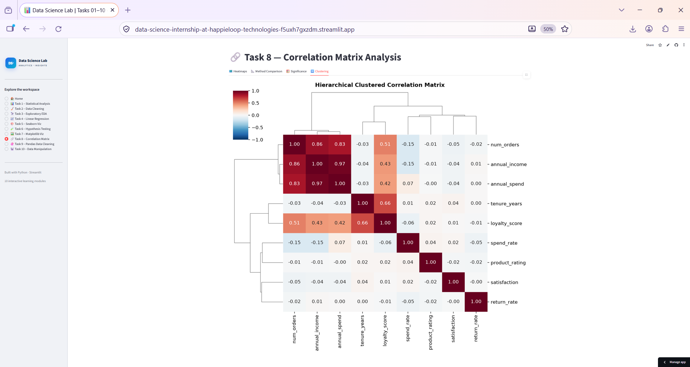 | 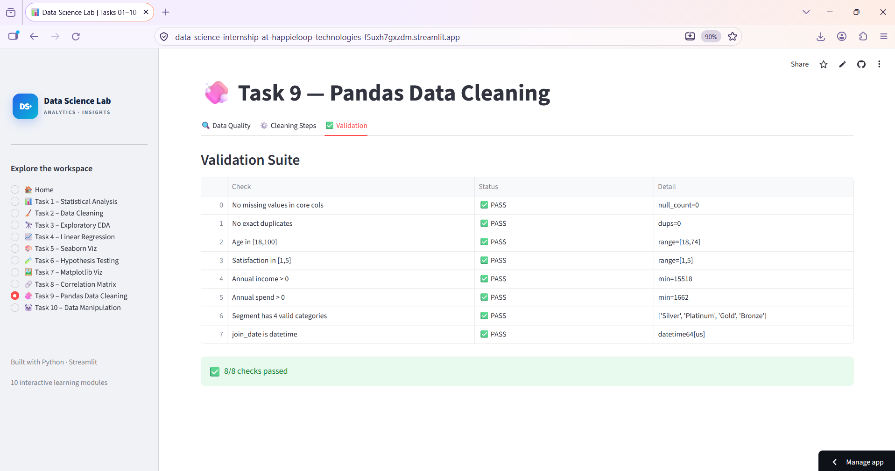 | 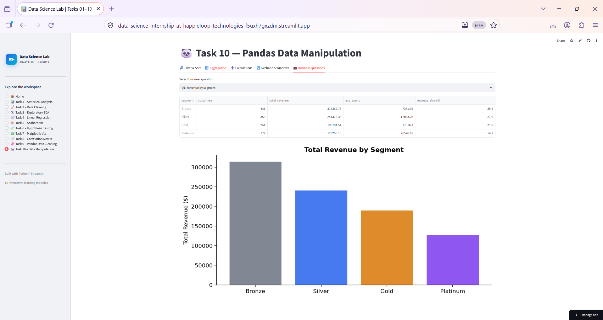 |

### 🎬 Live Walkthrough


</div>

---

## 🧭 What's Inside

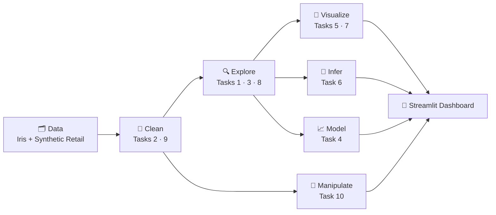

### 📚 The 10 Tasks

| # | Task | What I Built | Interactive Features | Key Techniques |
|:-:|------|--------------|----------------------|----------------|
| **1** | 📊 **Basic Statistics** | Descriptive analysis of the Iris dataset (150 × 4 × 3 species) | Feature selector · histogram/density/box views | Mean · median · std · skew · ANOVA · Shapiro-Wilk |
| **2** | 🧹 **Data Cleaning & Preprocessing** | Pipeline on a deliberately messy customer dataset | Raw vs. cleaned vs. before/after tabs | Imputation · outliers · encoding · scaling · validation |
| **3** | 🔭 **Exploratory Data Analysis** | Full EDA on retail customer data | Pick any X / Y / color-by combination | Univariate · bivariate · correlation heatmap |
| **4** | 📈 **Linear Regression** | Spend-vs-income model with diagnostics | OLS / Ridge / Lasso toggle · predictor selector | R² · RMSE · cross-validation · residual analysis |
| **5** | 🎨 **Seaborn Visualization** | Chart gallery with consistent theming | Chart-type dropdown · feature selector | Distribution, categorical, relational, matrix & facet plots |
| **6** | 🧪 **Hypothesis Testing** | Business questions answered with statistical rigor | Choose test, groups & outcome live | t-tests · ANOVA · Chi-square · Mann-Whitney · Kruskal-Wallis · effect size · power |
| **7** | 🖼️ **Matplotlib Visualization** | Custom chart library incl. multi-panel dashboard | Chart-type picker | GridSpec layouts · annotations · custom styling |
| **8** | 🔗 **Correlation Matrix** | Relationship analysis across all numeric features | Pearson / Spearman / Kendall switch · target ranking | Significance testing · hierarchical clustering |
| **9** | 🧼 **Pandas Data Cleaning** | Step-by-step cleaning walkthrough | Step explorer · validation suite | Type fixes · dedup · outliers · automated checks |
| **10** | 🐼 **Data Manipulation** | Answering business questions with Pandas | Live filter/sort · groupby · pivot | Filter · sort · groupby · pivot · melt · binning · rolling windows |

---

## 🎯 Skills Demonstrated

<table>
<tr>
<td width="33%" valign="top">

**🧹 Data Preparation**
- Missing-value strategies
- Outlier detection & treatment
- Encoding & scaling
- Deduplication & type fixes
- Automated validation checks

</td>
<td width="33%" valign="top">

**📐 Statistics & Modeling**
- Descriptive statistics
- Parametric & non-parametric tests
- Effect size & power analysis
- Linear, Ridge & Lasso regression
- Assumption & residual diagnostics

</td>
<td width="33%" valign="top">

**📊 Visualization & Delivery**
- Seaborn & Matplotlib
- Correlation heatmaps & clustering
- Multi-panel dashboards
- Streamlit app development
- Cloud deployment

</td>
</tr>
</table>

---

## 🧪 Highlight: Hypothesis Testing (Task 6)

Rather than printing a p-value, the dashboard lets you **choose the test, the groups and the outcome**, then reports the decision with effect size.

```text
Example question  →  Do Gold customers spend more than Bronze customers?
Test              →  Welch two-sample t-test  (unequal variances)
Output            →  t-statistic · p-value · Cohen's d · Reject / Fail-to-reject H₀
Also available    →  One-sample t · ANOVA · Chi-square · Mann-Whitney U · Kruskal-Wallis · Power analysis
```

## 📈 Highlight: Regression Diagnostics (Task 4)

Goes beyond fitting a line — compares **OLS vs. Ridge vs. Lasso**, reports **R² and RMSE**, runs **cross-validation**, and checks **linearity, normality of residuals and homoscedasticity**.

---

## 🗂️ Datasets

| Dataset | Used In | Description |
|---------|---------|-------------|
| 🌸 **Iris** | Task 1 | 150 samples · 4 measurements · 3 species (generated to mirror the classic dataset) |
| 🛒 **Synthetic Retail Customers** | Tasks 2–10 | 1,200 customers · demographics, segment (Bronze → Platinum), region, channel, income, spend, orders, satisfaction, tenure, discounts, returns |

> ℹ️ All data is **generated in code with fixed random seeds** → fully reproducible, no external files, no privacy concerns.

---

## ⚡ Quick Start

```bash
# 1. Clone
git clone https://github.com/<your-username>/<your-repo>.git
cd <your-repo>

# 2. Install
pip install -r requirements.txt

# 3. Run
streamlit run app.py
```

The app opens at **http://localhost:8501**.

<details>
<summary><b>📦 requirements.txt</b></summary>

```text
streamlit
numpy
pandas
matplotlib
seaborn
scipy
scikit-learn
statsmodels
```

</details>

## 📓 Notebooks

Each notebook follows the same structure: **Objective → Setup → Data → Analysis → Visualization → Insights → Conclusion.**

| Task | Notebook |
|:-:|---|
| 1 | [Analyze a Dataset's Basic Statistics](notebooks/Task_1_Analyze_a_Dataset_s_Basic_Statistics.ipynb) |
| 2 | [Data Cleaning and Preprocessing](notebooks/Task_2_Data_Cleaning_and_Preprocessing.ipynb) |
| 3 | [Exploratory Data Analysis (EDA)](notebooks/Task_3_Exploratory_Data_Analysis__EDA_.ipynb) |
| 4 | [Linear Regression Analysis](notebooks/Task_4_Linear_Regression_Analysis.ipynb) |
| 5 | [Data Visualization with Seaborn](notebooks/Task_5_Data_Visualization_with_Seaborn.ipynb) |
| 6 | [Perform a Hypothesis Test](notebooks/Task_6_Perform_a_Hypothesis_Test.ipynb) |
| 7 | [Basic Data Visualization with Matplotlib](notebooks/Task_7_Create_a_Basic_Data_Visualization_with_Matplotlib.ipynb) |
| 8 | [Correlation Matrix & Heatmap](notebooks/Task_8_Calculate_and_Visualize_Correlation_Matrix.ipynb) |
| 9 | [Basic Data Cleaning with Pandas](notebooks/Task_9_Basic_Data_Cleaning_with_Pandas.ipynb) |
| 10 | [Basic Data Manipulation with Pandas](notebooks/Task_10_Basic_Data_Manipulation_with_Pandas.ipynb) |

📄 Original task briefs: [`Data_Science.pdf`](docs/Data_Science.pdf)

---

## 📁 Project Structure

```text
├── app.py                  # Streamlit app — all 10 tasks, sidebar navigation
├── requirements.txt        # Python dependencies
├── README.md
├── notebooks/              # Task_1 … Task_10 Jupyter notebooks
└── docs/
    ├── Data_Science.pdf    # Task descriptions
    └── screenshots/        # README images & demo GIF
```

## 🌐 Deploy Your Own (Free)

1. Push this repo to GitHub
2. Open [share.streamlit.io](https://share.streamlit.io) → **New app**
3. Select the repo, set **`app.py`** as the main file
4. Click **Deploy** — live in ~2 minutes

---

## 🛠️ Tech Stack

| Layer | Tools |
|-------|-------|
| **Language** | Python |
| **Data** | Pandas · NumPy |
| **Statistics** | SciPy · Statsmodels |
| **Machine Learning** | scikit-learn (Linear, Ridge, Lasso, preprocessing, CV) |
| **Visualization** | Matplotlib · Seaborn |
| **App & Deployment** | Streamlit · Streamlit Community Cloud · Git/GitHub |
| **Notebooks** | Jupyter |

---

## 👤 Author

<div align="center">

### **P Suman Sangeet**
PGDM — Big Data Analytics · Data Science & AI Intern

[](https://clever-jelly-a82e9f.netlify.app)
[](https://www.linkedin.com/in/<your-handle>)
[](https://github.com/<your-username>)
[](mailto:<your-email>)

*Seeking Data Analyst / Data Scientist opportunities.*

⭐ **If this project helped you, consider giving it a star!** ⭐

</div>
